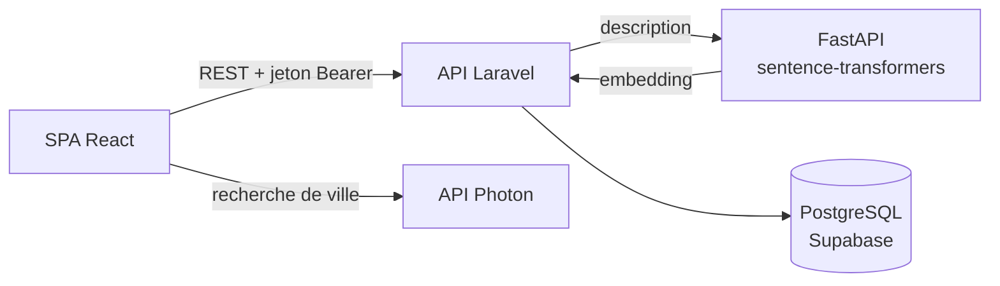

# HumanKind

[English](README.md) · **Français**


HumanKind est une application web où chacun peut offrir un peu de son temps : une conversation en anglais autour d'un café, une initiation au jardinage, un coup de main pour les courses. D'autres personnes demandent à participer, l'organisateur valide, et c'est seulement à ce moment-là que l'adresse et le téléphone sont partagés.

Pour publier une offre, on ne choisit pas de catégorie. Un service Python lit la description et la choisit lui-même, en français, en portugais ou en anglais.

J'ai conçu et développé seul ce projet full-stack pendant ma formation au titre professionnel *Développeur Web et Web Mobile* (RNCP niveau 5).


---

## Ce que montre ce projet

- **API REST avec Laravel 12** : authentification par jeton (Sanctum), validation avec des FormRequests, règles d'autorisation, middleware admin sur mesure, codes HTTP cohérents
- **Application React 19 (SPA)** : routage, formulaires contrôlés, appels à l'API avec gestion des erreurs, mise en page responsive sans bibliothèque d'interface
- **Conception de base de données relationnelle** : PostgreSQL avec migrations, clés étrangères, suppressions en cascade et une relation plusieurs-à-plusieurs porteuse de données
- **Intégration d'IA** : un microservice FastAPI qui transforme le texte en embeddings, comparés en PHP par similarité cosinus pour classer les annonces
- **Protection des données dès la conception** : informations privées masquées par défaut dans l'API et révélées uniquement aux participants validés ; suppression du compte
- **API externes** : autocomplétion des villes et géolocalisation avec Photon (OpenStreetMap), recherche par rayon avec la formule de haversine
- **Tests et débogage** : chaque route testée avec Postman, cas de réussite et d'échec, avant de construire l'interface

---

## Captures d'écran

| Détail d'une annonce et demande de participation | Proposer mon aide (aperçu en direct) |
|---|---|
|  |  |

| Mes demandes (coordonnées visibles après validation) | Demandes reçues (valider ou refuser) |
|---|---|
|  |  |

| Connexion | Inscription | Déconnexion |
|---|---|---|
|  |  |  |

---

## Fonctionnalités

- Inscription, connexion, déconnexion (jeton révoqué côté serveur), suppression du compte
- Publication d'une offre : titre, description, date, ville, et informations privées (adresse, téléphone)
- Recherche par mots-clés, catégorie, date et ville, rayon de 5 à 50 km, tri et pagination
- Demande de participation avec un petit message, puis suivi du statut : en attente, validée ou refusée
- Côté organisateur, validation ou refus des demandes reçues
- Espace d'administration pour gérer les utilisateurs et les annonces (le rôle admin ne peut être attribué qu'en ligne de commande)

---

## Architecture



| Couche | Technologies |
|---|---|
| Front-end | React 19, Vite, React Router, CSS |
| Back-end | Laravel 12 (PHP 8.3), Sanctum |
| Base de données | PostgreSQL (Supabase) |
| Service d'IA | Python, FastAPI, sentence-transformers (`paraphrase-multilingual-MiniLM-L12-v2`) |
| Outils | Git, GitHub, Postman, VS Code |

**Comment fonctionne la catégorisation :** la description est convertie en un vecteur de 384 nombres qui représente son sens. Laravel le compare au vecteur de chaque catégorie et garde la plus proche. Si aucune n'est assez proche (score inférieur à 0,25), l'annonce va dans *Autres* plutôt que dans une mauvaise catégorie.

---

## Tests

J'ai d'abord construit l'API et testé chaque route dans Postman avant d'écrire l'interface : le cas normal, puis chaque façon dont la requête doit échouer. Chaque parcours a ensuite été testé de bout en bout dans le navigateur avec plusieurs comptes, sur ordinateur, tablette et téléphone.

<details>
<summary><b>Cas de test Postman</b> (cliquer pour afficher)</summary>

En-têtes envoyés à chaque requête :

```http
Accept: application/json
Content-Type: application/json
Authorization: Bearer <jeton renvoyé par /login>
```

**Authentification**

| Requête | Cas | Résultat attendu |
|---|---|---|
| `POST /register` | données valides | 201, utilisateur et jeton |
| `POST /register` | email déjà utilisé, mot de passe de moins de 8 caractères, confirmation absente | 422 avec l'erreur de chaque champ |
| `POST /login` | identifiants corrects | 200, jeton |
| `POST /login` | mauvais mot de passe ou email inconnu | 401, même message dans les deux cas |
| `GET /user` | sans jeton, ou jeton révoqué | 401 |
| `POST /logout` | puis réutilisation du même jeton | 401 |
| `DELETE /user` | mauvais mot de passe | 422, compte conservé |

**Annonces**

| Requête | Cas | Résultat attendu |
|---|---|---|
| `POST /listings` | annonce valide | 201, avec la catégorie choisie par le service d'IA |
| `POST /listings` | titre de moins de 5 caractères, date passée, téléphone invalide | 422 |
| `POST /listings` | service d'IA arrêté | 503, rien n'est enregistré |
| `GET /listings` | | adresse, téléphone et embedding absents du JSON |
| `GET /listings/999` | annonce inexistante | 404 |

**Participations** (deux comptes : un organisateur et un participant)

| Requête | Cas | Résultat attendu |
|---|---|---|
| `POST /listings/{id}/participate` | première demande | 201, statut `pending` |
| `POST /listings/{id}/participate` | même demande une deuxième fois | 409 |
| `POST /listings/{id}/participate` | l'organisateur sur sa propre annonce | 403 |
| `GET /listings/{id}/participations` | le participant à la place de l'organisateur | 403 |
| `PATCH /participations/{id}` | organisateur, `approved` | 200 |
| `PATCH /participations/{id}` | même requête une deuxième fois | 409 |
| `PATCH /participations/{id}` | le participant tente de valider sa propre demande | 403 |
| `PATCH /participations/{id}` | statut autre que `approved` / `rejected` | 422 |
| `GET /my-activities` | demande en attente | ni adresse, ni téléphone, ni email de l'organisateur |
| `GET /my-activities` | demande validée | adresse, téléphone et email de l'organisateur inclus |

**Administration**

| Requête | Cas | Résultat attendu |
|---|---|---|
| `GET /admin/users` | utilisateur standard | 403 |
| `GET /admin/users` | admin | 200, avec le nombre d'annonces par utilisateur |
| `DELETE /admin/users/{id}` | l'admin supprime son propre compte | 422 |
| `DELETE /admin/users/{id}` | autre utilisateur | 200, ses annonces et participations sont aussi supprimées |

**Catégorisation :** `php artisan listings:recategorize --dry-run` affiche, pour chaque annonce, l'ancienne catégorie, la nouvelle et le score, sans rien enregistrer. C'est ainsi que j'ai découvert que « cours » était associé à « courses », ce qui a conduit au seuil et à la catégorie *Autres*.

</details>

<details>
<summary><b>Routes de l'API</b> (cliquer pour afficher)</summary>

Toutes les routes sont préfixées par `/api`.

| Méthode | Route | Accès | Description |
|---|---|---|---|
| POST | `/register` | public | Créer un compte, renvoie un jeton |
| POST | `/login` | public | Se connecter, renvoie un jeton |
| POST | `/logout` | utilisateur | Révoquer le jeton actuel |
| GET | `/user` | utilisateur | Utilisateur connecté |
| DELETE | `/user` | utilisateur | Supprimer le compte (`password` requis) |
| GET | `/listings` | utilisateur | Toutes les annonces |
| POST | `/listings` | utilisateur | Créer une annonce (catégorie choisie par le service d'IA) |
| GET | `/listings/{listing}` | utilisateur | Détail d'une annonce |
| GET | `/my-listings` | utilisateur | Mes annonces avec les demandes reçues |
| GET | `/categories` | utilisateur | Toutes les catégories |
| GET | `/categories/{category}/listings` | utilisateur | Annonces d'une catégorie |
| POST | `/listings/{listing}/participate` | utilisateur | Demander à participer (`comment` facultatif) |
| GET | `/my-activities` | utilisateur | Mes demandes et leur statut |
| GET | `/listings/{listing}/participations` | organisateur | Demandes reçues pour une annonce |
| PATCH | `/participations/{participation}` | organisateur | `{"status": "approved"}` ou `"rejected"` |
| GET | `/admin/users` | admin | Tous les utilisateurs |
| DELETE | `/admin/users/{user}` | admin | Supprimer un utilisateur |
| GET | `/admin/listings` | admin | Toutes les annonces |
| DELETE | `/admin/listings/{listing}` | admin | Supprimer une annonce |

</details>

<details>
<summary><b>Lancer le projet en local</b> (cliquer pour afficher)</summary>

Prérequis : PHP 8.3 avec `pdo_pgsql`, Composer, Node.js 20+, Python 3.10+, une base PostgreSQL.

```bash
# 1. Service d'IA (le modèle est téléchargé au premier démarrage)
cd embedding-service
python -m venv venv
venv\Scripts\activate            # macOS / Linux : source venv/bin/activate
pip install -r requirements.txt
python -m uvicorn main:app --port 8001

# 2. API Laravel
cd humankind
composer install
cp .env.example .env             # renseigner les variables DB_*
php artisan key:generate
php artisan migrate
php artisan db:seed --class=CategorySeeder
php artisan serve --port=8080

# 3. Front-end React
cd front-end
npm install
cp .env.example .env             # VITE_API_URL=http://127.0.0.1:8080/api
npm run dev                      # http://localhost:5173
```

Commandes utiles : `php artisan admin:promote vous@exemple.com` (donner le rôle admin), `php artisan listings:recategorize --dry-run` (prévisualiser les changements de catégorie), `php artisan listings:geocode` (ajouter les coordonnées aux anciennes annonces).

</details>

---

## Prochaines améliorations

- Tests automatisés : transformer les cas Postman en tests PHPUnit et en une collection exécutable avec le Postman CLI
- Sécurité avant la mise en ligne : limitation des tentatives de connexion, authentification par cookie plutôt qu'un jeton dans le `localStorage`, URL du service d'IA et origines CORS dans le `.env`
- Une contrainte d'unicité en base sur les participations, en plus de la vérification dans le code
- Filtres et pagination côté serveur, et recherche par le sens grâce aux embeddings des annonces (pgvector)
- Notifications par email, vue carte et traductions (FR / PT / EN)
- Déploiement : hébergement statique pour le front-end, VPS pour l'API, conteneur Docker pour le service d'IA

---

