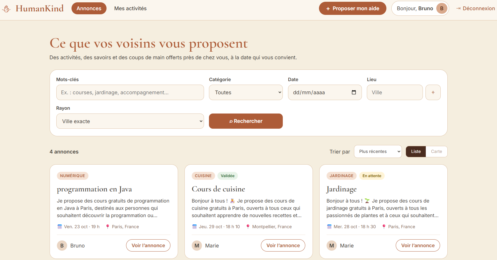
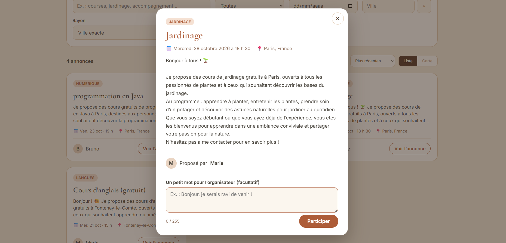
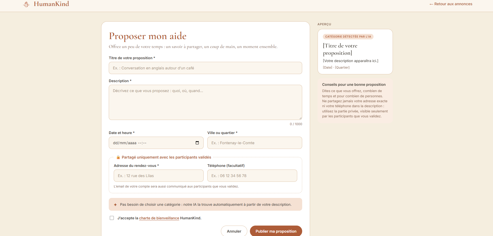
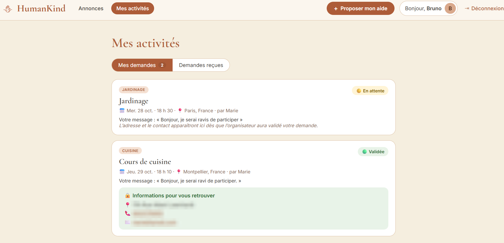
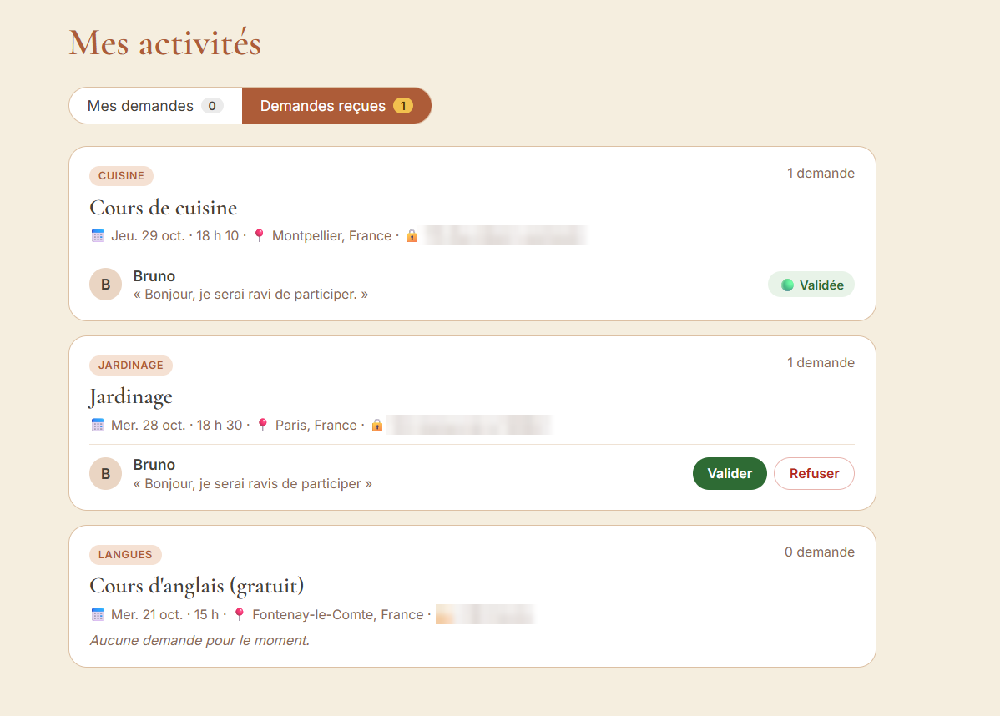
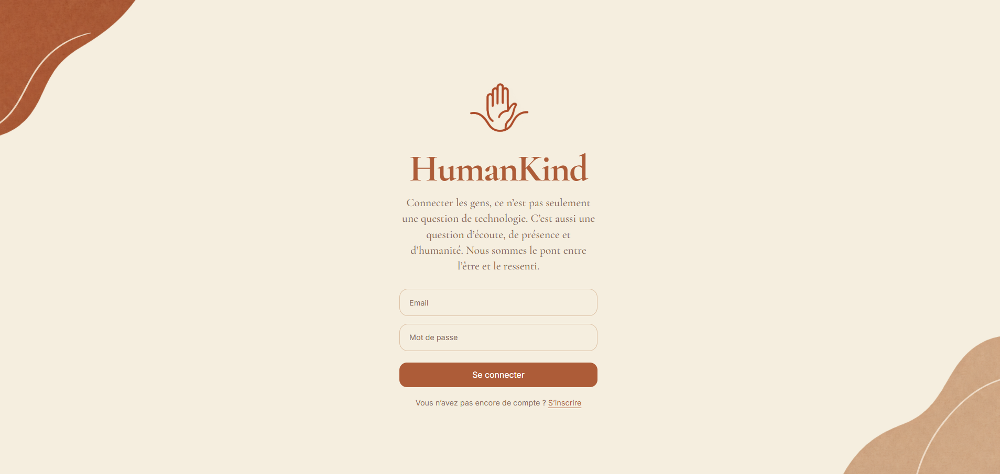
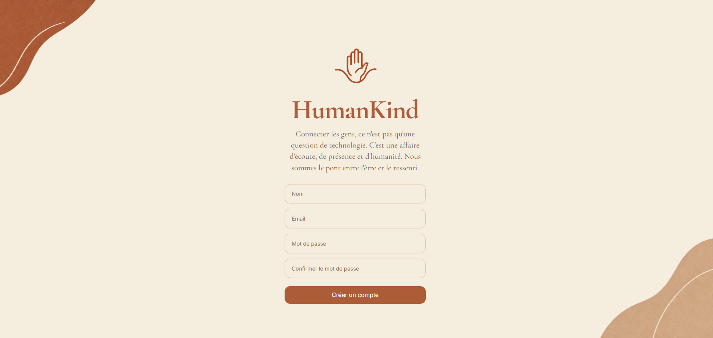
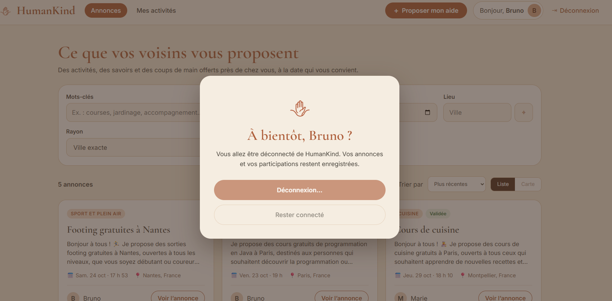
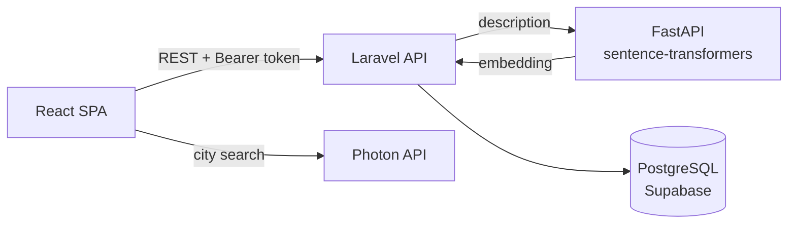

# HumanKind

**English** · [Français](README.fr.md)


HumanKind is a web app where people offer their free time to others: an English conversation over coffee, a gardening lesson, help with groceries. Others ask to join, the organizer approves, and only then are the address and phone number shared.

When someone publishes an offer, they don't pick a category. A Python service reads the description and chooses it, in French, Portuguese or English.

I designed and built this full-stack project on my own during my training for the French *Développeur Web et Web Mobile* certification (RNCP level 5).



---

## What this project shows

- **REST API in Laravel 12**: token authentication (Sanctum), validation with FormRequests, authorization rules, a custom admin middleware, consistent HTTP status codes
- **React 19 single-page app**: routing, controlled forms, API calls with error handling, a responsive layout built without a UI library
- **Relational database design**: PostgreSQL with migrations, foreign keys, cascade deletes and a many-to-many relation carrying its own data
- **AI integration**: a FastAPI microservice that turns text into embeddings, compared in PHP with cosine similarity to categorize listings
- **Privacy by design**: private details hidden by default in the API and revealed only to approved participants; account deletion
- **Third-party APIs**: city autocomplete and geolocation with Photon (OpenStreetMap), radius search with the haversine formula
- **Testing and debugging**: every route tested with Postman, success and failure cases, before building the interface

---

## Screenshots

| Listing details and participation request | Offer your help (live preview) |
|---|---|
|  |  |

| My requests (details shown once approved) | Requests received (approve or reject) |
|---|---|
|  |  |

| Log in | Sign up | Log out |
|---|---|---|
|  |  |  |

---

## Features

- Sign up, log in, log out (token revoked on the server), delete your account
- Publish an offer: title, description, date, city, and private details (address, phone)
- Browse offers with keyword, category, date and city filters, a 5 to 50 km radius, sorting and pagination
- Ask to join with a short message, then follow the status: pending, approved or rejected
- As an organizer, approve or reject the requests received
- Admin area to manage users and listings (the admin role can only be granted from the command line)

---

## Architecture



| Layer | Technology |
|---|---|
| Front-end | React 19, Vite, React Router, CSS |
| Back-end | Laravel 12 (PHP 8.3), Sanctum |
| Database | PostgreSQL (Supabase) |
| AI service | Python, FastAPI, sentence-transformers (`paraphrase-multilingual-MiniLM-L12-v2`) |
| Tools | Git, GitHub, Postman, VS Code |

**How the categorization works:** the description is converted into a 384-number vector that represents its meaning. Laravel compares it with the vector of each category and keeps the closest one. If nothing is close enough (score below 0.25), the listing goes into *Autres* instead of a wrong category.

---

## Testing

I built the API first and tested each route in Postman before writing the interface: the normal case first, then every way the request should fail. Each user flow was then tested end to end in the browser with several accounts, on desktop, tablet and phone widths.

<details>
<summary><b>Postman test cases</b> (click to expand)</summary>

Headers sent with every request:

```http
Accept: application/json
Content-Type: application/json
Authorization: Bearer <token returned by /login>
```

**Authentication**

| Request | Case | Expected |
|---|---|---|
| `POST /register` | valid data | 201, user and token |
| `POST /register` | email already used, password under 8 characters, confirmation missing | 422 with the error per field |
| `POST /login` | correct credentials | 200, token |
| `POST /login` | wrong password or unknown email | 401, same message in both cases |
| `GET /user` | no token, or a revoked token | 401 |
| `POST /logout` | then reuse the same token | 401 |
| `DELETE /user` | wrong password | 422, account kept |

**Listings**

| Request | Case | Expected |
|---|---|---|
| `POST /listings` | valid listing | 201, with the category chosen by the AI service |
| `POST /listings` | title under 5 characters, date in the past, invalid phone | 422 |
| `POST /listings` | AI service stopped | 503, nothing saved |
| `GET /listings` | | address, phone and embedding absent from the JSON |
| `GET /listings/999` | listing that does not exist | 404 |

**Participations** (two accounts: an organizer and a participant)

| Request | Case | Expected |
|---|---|---|
| `POST /listings/{id}/participate` | first request | 201, status `pending` |
| `POST /listings/{id}/participate` | same request a second time | 409 |
| `POST /listings/{id}/participate` | organizer on their own listing | 403 |
| `GET /listings/{id}/participations` | participant instead of organizer | 403 |
| `PATCH /participations/{id}` | organizer, `approved` | 200 |
| `PATCH /participations/{id}` | same request again | 409 |
| `PATCH /participations/{id}` | participant tries to approve themself | 403 |
| `PATCH /participations/{id}` | status other than `approved` / `rejected` | 422 |
| `GET /my-activities` | pending request | no address, phone or organizer email |
| `GET /my-activities` | approved request | address, phone and organizer email included |

**Administration**

| Request | Case | Expected |
|---|---|---|
| `GET /admin/users` | regular user | 403 |
| `GET /admin/users` | admin | 200, with the number of listings per user |
| `DELETE /admin/users/{id}` | admin deletes their own account | 422 |
| `DELETE /admin/users/{id}` | other user | 200, their listings and participations deleted too |

**Categorization:** `php artisan listings:recategorize --dry-run` shows, for each listing, the old category, the new one and the score, without saving anything. That is how I found that "cours" (lessons) was being matched with "courses" (groceries), which led to the threshold and the *Autres* category.

</details>

<details>
<summary><b>API reference</b> (click to expand)</summary>

All routes are prefixed with `/api`.

| Method | Route | Access | Description |
|---|---|---|---|
| POST | `/register` | public | Create an account, returns a token |
| POST | `/login` | public | Log in, returns a token |
| POST | `/logout` | user | Revoke the current token |
| GET | `/user` | user | Current user |
| DELETE | `/user` | user | Delete the account (`password` required) |
| GET | `/listings` | user | All listings |
| POST | `/listings` | user | Create a listing (category chosen by the AI service) |
| GET | `/listings/{listing}` | user | Listing details |
| GET | `/my-listings` | user | My listings with the requests received |
| GET | `/categories` | user | All categories |
| GET | `/categories/{category}/listings` | user | Listings in a category |
| POST | `/listings/{listing}/participate` | user | Ask to join (optional `comment`) |
| GET | `/my-activities` | user | My requests and their status |
| GET | `/listings/{listing}/participations` | organizer | Requests received for a listing |
| PATCH | `/participations/{participation}` | organizer | `{"status": "approved"}` or `"rejected"` |
| GET | `/admin/users` | admin | All users |
| DELETE | `/admin/users/{user}` | admin | Delete a user |
| GET | `/admin/listings` | admin | All listings |
| DELETE | `/admin/listings/{listing}` | admin | Delete a listing |

</details>

<details>
<summary><b>Run it locally</b> (click to expand)</summary>

Requirements: PHP 8.3 with `pdo_pgsql`, Composer, Node.js 20+, Python 3.10+, a PostgreSQL database.

```bash
# 1. AI service (the model is downloaded on the first start)
cd embedding-service
python -m venv venv
venv\Scripts\activate            # macOS / Linux: source venv/bin/activate
pip install -r requirements.txt
python -m uvicorn main:app --port 8001

# 2. Laravel API
cd humankind
composer install
cp .env.example .env             # fill in the DB_* variables
php artisan key:generate
php artisan migrate
php artisan db:seed --class=CategorySeeder
php artisan serve --port=8080

# 3. React front-end
cd front-end
npm install
cp .env.example .env             # VITE_API_URL=http://127.0.0.1:8080/api
npm run dev                      # http://localhost:5173
```

Useful commands: `php artisan admin:promote you@example.com` (give the admin role), `php artisan listings:recategorize --dry-run` (preview category changes), `php artisan listings:geocode` (add coordinates to old listings).

</details>

---

## What I would improve next

- Automated tests: turn the Postman cases into PHPUnit feature tests and a collection that runs with the Postman CLI
- Security before deployment: login rate limiting, cookie-based authentication instead of a token in `localStorage`, AI service URL and CORS origins in `.env`
- A unique database constraint on participations, in addition to the check in the code
- Server-side filtering and pagination, and search by meaning using the listing embeddings (pgvector)
- Email notifications, a map view, and translations (FR / PT / EN)
- Deployment: static hosting for the front-end, a VPS for the API, a Docker container for the AI service

---
